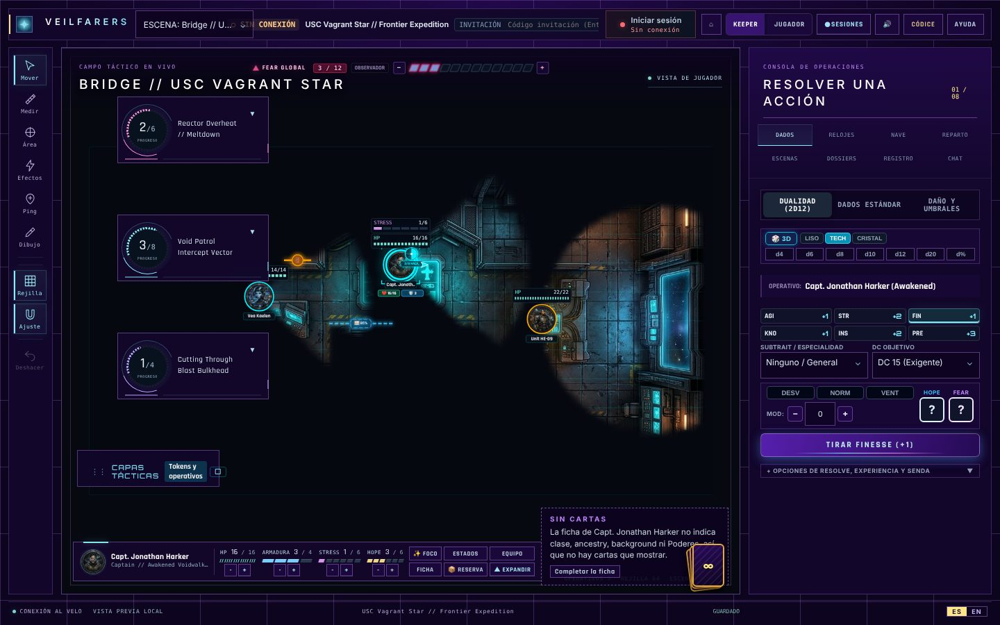

# Propuesta · Simplificar la interfaz de la mesa (rama V3)

> Estado: **propuesta, sin código**. Las imágenes «después» son maquetas aproximadas: la interfaz real con elementos ocultos o agrupados, no la versión final.
> Base: `main` estable en v2.15.2. Nada de esto toca las reglas ni las 21 decisiones consolidadas de `HANDOVER_V2.md`.

## 1. Diagnóstico

Medido en la mesa a 1440 × 900, como Keeper:

| Zona | Controles a la vista hoy |
| --- | --- |
| Cabecera | 17 (escena, estado, invitación, copiar, enlace, tripulación, unirse, cuenta, inicio, Keeper/Jugador, Sesiones, audio, Códice, Ayuda…) |
| Herramientas (izquierda) | 16 (Mover, Medir, Área, Efectos, Ping, Dibujo, Muros, Luces, Anomalía, Agua, Escala, Visión, Niebla, Rejilla, Ajuste, Deshacer) |
| Pestañas (derecha) | 8: Dados, Relojes, Nave, Reparto, Escenas, Dossiers, Registro, Chat |
| Dentro de cada pestaña | Dados 44 · Nave 46 · Escenas 36 · Reparto 25 · Relojes 22 · Dossiers 13 · Chat 11 · Registro 9 |
| Capas sobre el mapa | 9: barra de Fear, panel de capas, relojes, barra del personaje, título, marco, lectura de campo, mano de cartas, guía |
| **Total a la vez** | **≈ 108 controles** (jugador: ≈ 95) |

Problemas concretos:

1. **Todo está a la vista todo el tiempo.** Las herramientas de editar el mapa (muros, luces, agua, anomalías, escala, niebla) se ven mientras se juega, cuando se usan sobre todo al preparar la escena.
2. **La cabecera mezcla tres cosas:** la sala (invitación, copiar, enlace, tripulación), la cuenta y la navegación (inicio, sesiones, códice, ayuda, audio).
3. **Hay ocho pestañas para cuatro tareas:** tirar, gestionar la mesa, preparar la escena y hablar.
4. **El mapa queda tapado.** Los relojes ocupan una columna entera a la izquierda y el panel de capas flota encima.
5. **El jugador ve casi lo mismo que el Keeper** (95 controles frente a 108), aunque usa una parte pequeña.

| Antes · Keeper | Antes · Jugador |
| --- | --- |
|  |  |

## 2. Principios

1. **Cada papel ve lo suyo.** El jugador no ve herramientas de Keeper ni pestañas que no puede usar.
2. **Jugar y preparar son modos distintos.** Editar la escena es un modo que se abre y se cierra, no una barra fija.
3. **Lo frecuente, a un clic; lo raro, a dos.** Nada desaparece: se agrupa detrás de un menú o de «Más opciones».
4. **El mapa manda.** Lo que flota sobre el mapa debe ser pequeño y plegable.
5. **No se tocan las reglas ni las decisiones consolidadas.** Las cartas, el mazo siempre visible, la tarjeta de resultado única, el idioma y el botón de inicio se mantienen.

## 3. Propuestas

| # | Cambio | De → a | Impacto | Esfuerzo |
| --- | --- | --- | --- | --- |
| 1 | **Cabecera**: un botón **Sala** (estado online, nombre, invitación, copiar, enlace y tripulación en un desplegable) y un botón **☰ Menú** (Inicio, Sesiones, Códice, Ayuda, audio, idioma). Se quedan fuera: escena, Keeper/Jugador y cuenta. | 17 → 6 | Alto | Medio |
| 2 | **Herramientas**: para jugar, Mover, Medir, Ping y Dibujo, más Deshacer. El Keeper tiene además **✎ Editar escena**, que abre un modo con Área, Efectos, Muros, Luces, Anomalía, Agua, Escala, Visión, Niebla, Rejilla, Ajuste y el panel de capas (que deja de flotar sobre el mapa). | 16 → 5 (jugador 4) | Alto | Medio |
| 3 | **Pestañas**: **Dados** · **Mesa** (Reparto + Relojes + Dossiers) · **Escena** (Escenas + Nave) · **Chat** (Chat + Registro). El jugador ve Dados, Mesa y Chat. | 8 → 4 (jugador 3) | Alto | Medio-alto |
| 4 | **Relojes**: una tira de fichas pequeñas bajo el título («Reactor 2/6»); un clic abre el reloj. | Columna → tira | Medio | Bajo |
| 5 | **Panel de dados**: a la vista, Trait, DC, Desventaja/Normal/Ventaja y TIRAR. Subtrait, modificador, Experiencia, Resolve y estilo 3D pasan a «Más opciones». El estilo de los dados se mueve a Preferencias. | 44 → ≈ 20 | Medio | Bajo |
| 6 | **Modo Básico/Avanzado en la mesa** (ya existe en el lobby): Básico aplica todo lo anterior; Avanzado muestra lo de hoy, para quien lo prefiera. Se recuerda por cuenta. | — | Alto | Medio |
| 7 | **Pestaña Nave**: solo aparece cuando la escena es de combate naval o el Keeper la activa. | 46 controles fuera del día a día | Medio | Bajo |
| 8 | **Un solo estilo visual**: terminar de pasar al violeta las piezas que siguen en el estilo Orbital antiguo y retirar los `!important` que se pisan (≈ 300). | Coherencia y menos errores como el del Fear en tablet | Medio | Alto |

| Después (maqueta) · Keeper | Después (maqueta) · Jugador |
| --- | --- |
|  |  |

## 4. Plan por fases (en V3)

1. **Fase A, lo que más se nota con menos riesgo**: 4 (relojes en tira), 5 (dados) y 7 (Nave a demanda). Unos pocos días; no cambia dónde están las cosas.
2. **Fase B, la estructura**: 1 (cabecera), 2 (Editar escena) y 3 (cuatro pestañas). Es lo que más simplifica; mueve botones de sitio, así que conviene probarlo jugando.
3. **Fase C, la red de seguridad**: 6 (Básico/Avanzado en la mesa), para que nadie pierda lo que usa hoy.
4. **Fase D, la deuda**: 8 (estilo único y limpieza de CSS), poco a poco, junto a lo demás.

Cada fase sale como versión en V3, con su changelog, sus pruebas y su entrada en `PRUEBAS_LOCALES.md`. `main` no cambia hasta que la valides.

## 5. Lo que necesito que decidas

1. **¿Te encaja agrupar en cuatro pestañas** (Dados · Mesa · Escena · Chat), o prefieres otra agrupación?
2. **¿«Editar escena» como modo aparte** te sirve, o el Keeper necesita los muros y las luces a mano durante la partida?
3. **¿Básico por defecto** para todos, con Avanzado como opción, o al revés?
4. **¿Por qué fase empiezo?** Mi recomendación es la A: es rápida, no rompe hábitos y deja ver el efecto antes de mover la estructura.

## 6. Riesgos

- **Mover botones cambia hábitos.** Por eso la fase C (Avanzado) y la guía de primeros pasos tendrán que actualizarse con la nueva ubicación.
- **Hay pruebas que buscan elementos por su sitio actual.** Se actualizarán en cada fase.
- **La traducción por texto exacto**: los textos nuevos irán al diccionario en el mismo cambio.
