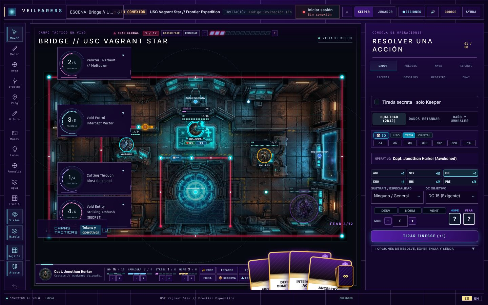
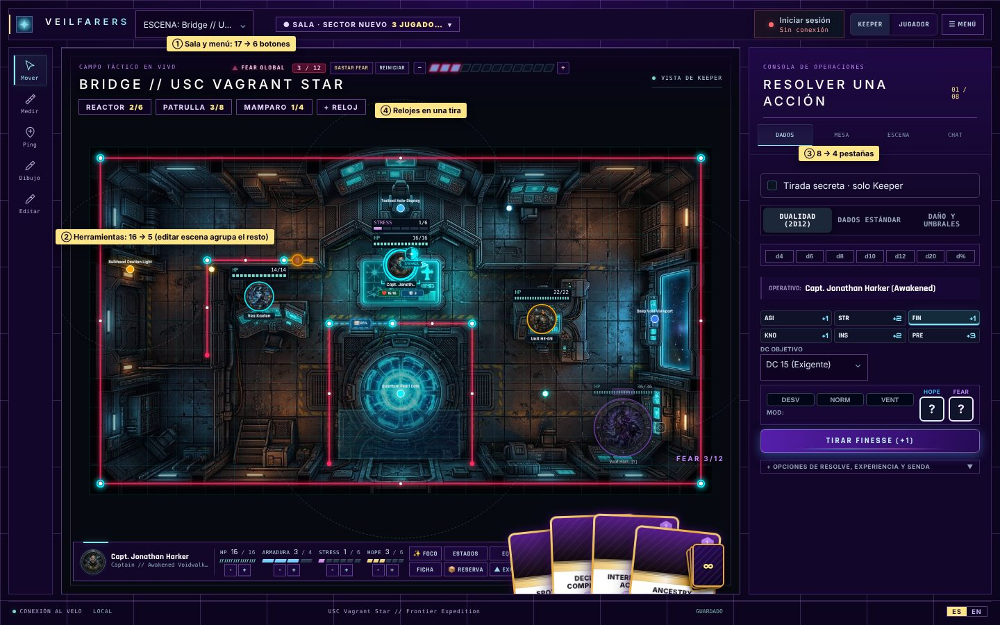
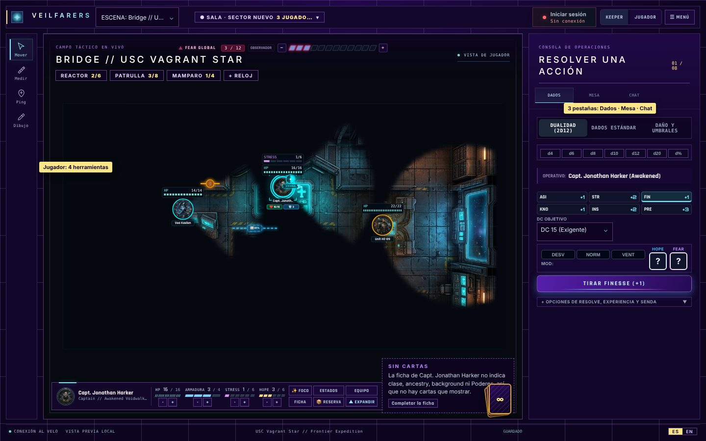

# Propuesta · Simplificar la interfaz de la mesa (rama V3)

> Estado: **propuesta, sin código**, reescrita con la regla del usuario: **3 a la vista + un desplegable con 5 + un último nivel con el resto**. Las imágenes «después» son maquetas aproximadas hechas antes de esa regla; se rehacen al cerrar el reparto.
> Base: `main` estable en v2.15.2. Nada de esto toca las reglas ni las 21 decisiones consolidadas de `HANDOVER_V2.md`.

## 1. Diagnóstico

Medido en la mesa a 1440 × 900, como Keeper:

| Zona | Controles a la vista hoy |
| --- | --- |
| Cabecera | 17 (escena, estado, invitación, copiar, enlace, tripulación, unirse, cuenta, inicio, Keeper/Jugador, Sesiones, audio, Códice, Ayuda…) |
| Herramientas (izquierda) | 16 (Mover, Medir, Área, Efectos, Ping, Dibujo, Muros, Luces, Anomalía, Agua, Escala, Visión, Niebla, Rejilla, Ajuste, Deshacer) |
| Pestañas (derecha) | 8: Dados, Relojes, Nave, Reparto, Escenas, Dossiers, Registro, Chat |
| Dentro de cada pestaña | Dados 44 · Nave 46 · Escenas 36 · Reparto 25 · Relojes 22 · Dossiers 13 · Chat 11 · Registro 9 |
| Capas sobre el mapa | 9: barra de Fear, panel de capas, relojes, barra del personaje, título, marco, lectura de campo, mano de cartas, guía |
| **Total a la vez** | **≈ 108 controles** (jugador: ≈ 95) |

Problemas concretos:

1. **Todo está a la vista todo el tiempo.** Las herramientas de editar el mapa (muros, luces, agua, anomalías, escala, niebla) se ven mientras se juega, cuando se usan sobre todo al preparar la escena.
2. **La cabecera mezcla tres cosas:** la sala (invitación, copiar, enlace, tripulación), la cuenta y la navegación (inicio, sesiones, códice, ayuda, audio).
3. **Hay ocho pestañas para cuatro tareas:** tirar, gestionar la mesa, preparar la escena y hablar.
4. **El mapa queda tapado.** Los relojes ocupan una columna entera a la izquierda y el panel de capas flota encima.
5. **El jugador ve casi lo mismo que el Keeper** (95 controles frente a 108), aunque usa una parte pequeña.

| Antes · Keeper | Antes · Jugador |
| --- | --- |
|  |  |

## 2. La regla: 3 + 5 + resto

Cada grupo de controles de la interfaz se ordena igual:

1. **Nivel 1 · a la vista: como máximo 3 elementos**, los más usados del grupo.
2. **Nivel 2 · un desplegable («⋯»): hasta 5 elementos más**, los siguientes en uso.
3. **Nivel 3 · el último despliegue («Más…», dentro del desplegable): todo lo demás.**

Es un solo componente para toda la app (`GroupMenu`). Así todos los grupos se comportan igual: se abre con clic o teclado, se cierra con Esc o al tocar fuera, y funciona en los dos idiomas y en tablet. Un grupo con 3 elementos o menos no tiene desplegable. Si tiene entre 4 y 8, solo tiene el desplegable, sin «Más…».

Criterio para repartir: la **frecuencia de uso durante la partida**. Preparar la escena, configurar o consultar baja de nivel; nada desaparece. Los atajos de teclado (B, D, U, Ctrl+Z…) siguen funcionando aunque el botón esté en un desplegable.

## 3. Reparto propuesto por grupo

Las listas de abajo son mi propuesta; cámbialas libremente.

### 3.1 Cabecera (hoy 17)

| | Keeper | Jugador |
| --- | --- | --- |
| **A la vista (3)** | Escena ▾ · Sala (estado online + nombre) · Keeper/Jugador | Escena ▾ · Sala · Mis tokens |
| **Desplegable (5)** | Invitar (código y enlace) · Tripulación · Cuenta · Sesiones · Ayuda | Cuenta · Sesiones · Ayuda · Tripulación · Invitar |
| **Más…** | Códice · Inicio · Unirse | Códice · Inicio · Unirse |

**Cuenta** incluye idioma, audio, preferencias (también el estilo 3D de los dados), partidas y notas, personajes y cerrar sesión. El reparto detallado de todas las funciones, con personas y prioridades, está en [`PERSONAS_Y_PRIORIDADES.md`](PERSONAS_Y_PRIORIDADES.md).

El logo VEILFARERS sigue llevando a Inicio con un clic. Así se mantiene la decisión 15 aunque el botón ⌂ baje al último nivel.

### 3.2 Herramientas (hoy 16)

| | Keeper | Jugador |
| --- | --- | --- |
| **A la vista (3)** | Mover · Medir · Dibujo | Mover · Medir · Dibujo |
| **Desplegable (5)** | Ping · Área · Efectos · Visión · Deshacer | Ping · Área · Efectos |
| **Más…** (preparar la escena) | Muros · Luces · Agua · Anomalía · Niebla · Escala · Rejilla · Ajuste · Capas | — |

El panel flotante de capas deja de estar sobre el mapa y pasa a «Más… → Capas».

### 3.3 Pestañas de la derecha (hoy 8)

| | Keeper | Jugador |
| --- | --- | --- |
| **A la vista (3)** | Dados · Reparto · Chat | Dados · Chat · Reparto |
| **Desplegable (5)** | Escenas · Relojes · Dossiers · Registro · Nave | Relojes · Registro · Dossiers |
| **Más…** | — | — |

### 3.4 Panel de dados, modo Dualidad (hoy 44)

| | |
| --- | --- |
| **A la vista (3)** | Trait (selector de 6) · DC · TIRAR |
| **Desplegable (5)** | Ventaja / Normal / Desventaja · Experiencia · Resolve · Tirada secreta (Keeper) · Subtrait |
| **Más…** | Modificador manual · Elección de crítico · «Tirada significativa» · Estilo 3D de los dados · Dados estándar (d4–d100) |

Los modos Dualidad · Dados estándar · Daño siguen siendo tres pestañas: ya cumplen la regla.

### 3.5 Barra del personaje (hoy 10 botones)

| | |
| --- | --- |
| **A la vista (3)** | Ficha · Estados · Equipo |
| **Desplegable (5)** | Foco (Spotlight) · Subir de nivel · Expandir · Reserva · Dron (si tiene) |
| **Más…** | Ajustes del token · Eliminar |

Las cifras de HP, Armor, Stress y Hope/Effort no son botones y siguen a la vista.

### 3.6 Ficha del personaje (hoy 4 pestañas + Básica/Completa + Condiciones + Guardar)

| | |
| --- | --- |
| **A la vista (3)** | Ficha · Armas y equipo · Rasgos |
| **Desplegable (5)** | Vínculos · Condiciones · Subir de nivel · Vista Básica/Completa · Exportar |
| **Más…** | JSON de origen · Boss (si es adversario) · Ajustes del token |

«Guardar ficha» sigue siendo un botón propio, porque es la acción final del formulario.

### 3.7 Pestaña Reparto (hoy 5 acciones arriba)

| | |
| --- | --- |
| **A la vista (3)** | + Personaje · Biblioteca de adversarios · Importar JSON |
| **Desplegable (5)** | + Dron · + Actor |

### 3.8 Sobre el mapa

No son botones, pero aplican la misma idea:
- A la vista quedan la barra de Fear, la mano de cartas con el mazo (decisión 21) y la barra del personaje.
- Los relojes pasan a una **tira** bajo el título («Reactor 2/6»). Con más de 3 relojes, los demás van en «⋯».
- La guía de primeros pasos sigue como está (minimizable).

## 4. Plan por fases (en V3)

> **Actualizado (17 nov 2026):** el usuario prioriza al jugador. La **Fase A pasa a ser la vista del jugador** (Tirar y Atacar en un clic, chat con aviso, el resto en «⋯» y «Más…»; ver `PERSONAS_Y_PRIORIDADES.md`, sección 2b). Las fases de abajo pasan a ser B–E y se aplican después, sobre todo a la vista del Keeper.

1. **Fase A**: el componente `GroupMenu` y su aplicación a **herramientas (3.2) y pestañas (3.3)**. Es lo que más espacio libera, y sirve para validar la regla jugando.
2. **Fase B**: **cabecera (3.1)** y **panel de dados (3.4)**.
3. **Fase C**: **barra del personaje (3.5)**, **ficha (3.6)**, **Reparto (3.7)** y **relojes en tira (3.8)**.
4. **Fase D, la deuda**: un solo estilo visual y limpieza de los ≈ 300 `!important`, poco a poco.

Cada fase sale como versión en V3, con su changelog, sus pruebas, su entrada en `PRUEBAS_LOCALES.md` y la guía de primeros pasos actualizada si algo cambia de sitio. `main` no cambia hasta que lo valides.

| Maqueta previa (antes de la regla) · Keeper | Maqueta previa · Jugador |
| --- | --- |
|  |  |

## 5. Lo que necesito que confirmes

1. **¿El reparto de cada grupo (3.1 a 3.7) te encaja?** Lo más dudoso:
   - Ping y Deshacer fuera de la vista. Deshacer sigue con Ctrl+Z.
   - Subtrait en el desplegable del panel de dados.
2. **¿Empiezo por la Fase A** (componente + herramientas + pestañas)?
3. **¿Quieres que cada persona pueda reordenar** qué 3 tiene a la vista (por ejemplo, arrastrando dentro del desplegable)? No está en la propuesta; se puede añadir después.

## 6. Riesgos

- **Mover botones cambia hábitos.** La guía de primeros pasos y la ayuda se actualizan en cada fase.
- **«Muéstramelo» de la guía** tendrá que abrir el desplegable cuando lo que señala esté dentro.
- **Las pruebas que buscan elementos por su sitio** se actualizan en cada fase.
- **Traducción por texto exacto**: los textos nuevos van al diccionario en el mismo cambio.
